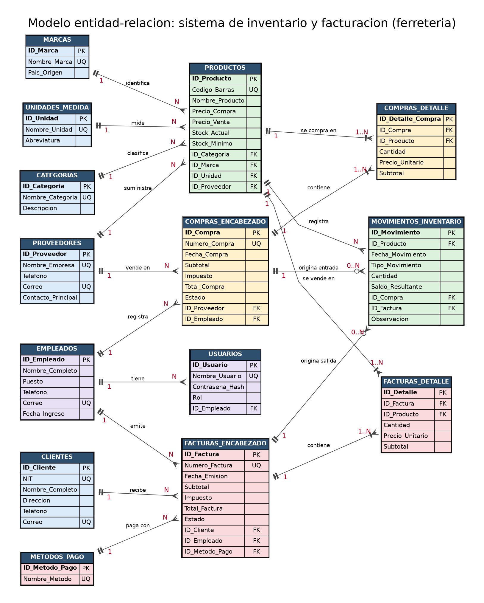

# Sistema de Inventario y Facturación (Ferretería)

**Proyecto final de Base de Datos I** · Universidad Mariano Gálvez de Guatemala · Facultad de Ingeniería en Sistemas de Información
**Catedrático:** Ing. Edwin Haroldo Alvarez Saquez · **Sección:** B
**Integrante:** Amada Noemi Cárcamo Renderos
**Fecha:** octubre de 2026

## Descripción

Base de datos relacional para una ferretería: administra el catálogo de productos, proveedores y clientes, controla las existencias con un kárdex y cubre el proceso completo de compras y facturación con su detalle. El alcance, las reglas de negocio y los módulos están en [docs/01_descripcion_sistema.md](docs/01_descripcion_sistema.md).

- **Modelo:** 14 tablas normalizadas hasta la tercera forma normal.
- **Datos de prueba:** 8 categorías, 15 proveedores, 18 clientes, 30 productos, 14 facturas con 39 líneas de detalle y 17 compras.
- **Lógica automática:** 3 triggers, 2 procedimientos almacenados (registrar factura y registrar compra) y 2 vistas que mantienen los totales, el stock y el kárdex.
- **Reportes:** 12 consultas (bajo stock, ventas por cliente, por producto y por mes, compras por proveedor, productos nunca vendidos y más).

## Motor de base de datos

Oracle Database 21c XE, esquema `FERRETERIADB`. Clientes SQL usados: DBeaver 25.2.0 y SQL*Plus 21.3.

## Diagrama entidad-relación



## Contenido

| Documento | Descripción |
|---|---|
| [docs/01_descripcion_sistema.md](docs/01_descripcion_sistema.md) | Descripción del sistema, reglas de negocio y alcance |
| [docs/02_diccionario_datos.md](docs/02_diccionario_datos.md) | Diccionario de datos de las 14 tablas |
| [docs/03_justificacion_relaciones.md](docs/03_justificacion_relaciones.md) | Cardinalidades, llaves foráneas y tabla puente |
| [docs/04_normalizacion.md](docs/04_normalizacion.md) | Análisis de 1FN, 2FN y 3FN |
| [docs/05_paso_a_paso.md](docs/05_paso_a_paso.md) | Guía de reproducción con capturas |
| [docs/img/modelo_relacional.png](docs/img/modelo_relacional.png) | Modelo relacional con todos los campos |
| [diagramas/](diagramas/) | Archivos fuente editables de los diagramas (Graphviz `.gv`) |

| Script | Descripción |
|---|---|
| [sql/01_ddl_crear_base_datos.sql](sql/01_ddl_crear_base_datos.sql) | Limpia el esquema `FERRETERIADB` |
| [sql/02_ddl_crear_tablas.sql](sql/02_ddl_crear_tablas.sql) | Crea las 14 tablas con sus restricciones |
| [sql/03_dml_datos_prueba.sql](sql/03_dml_datos_prueba.sql) | Inserta los datos de prueba y verifica la carga |
| [sql/04_consultas_reportes.sql](sql/04_consultas_reportes.sql) | Consultas y reportes |
| [sql/05_logica_automatica.sql](sql/05_logica_automatica.sql) | Triggers, procedimientos almacenados y vistas |

## Ejecución rápida

Conectado al esquema `FERRETERIADB` de Oracle 21c XE, ejecutar en este orden (SQL*Plus o DBeaver):

```sql
@sql/01_ddl_crear_base_datos.sql
@sql/02_ddl_crear_tablas.sql
@sql/03_dml_datos_prueba.sql
@sql/04_consultas_reportes.sql
@sql/05_logica_automatica.sql
```

Los requisitos, cómo verificar cada paso, la ejecución con DBeaver y los problemas comunes están en [docs/05_paso_a_paso.md](docs/05_paso_a_paso.md).
