# Paso a paso: reproducir la base de datos desde cero

Esta guía permite a cualquier persona crear la base de datos únicamente con los scripts del repositorio.

## 1. Requisitos previos

| Requisito | Detalle |
|---|---|
| Motor | Oracle Database 21c XE |
| Esquema | `FERRETERIADB` ya creado, con permiso para crear tablas |
| Cliente SQL | SQL*Plus 21.3 o DBeaver 25.2.0 |
| Git | Para clonar el repositorio (o descargar el ZIP desde GitHub) |

En Oracle la «base de datos» de trabajo es el esquema. Todos los scripts se ejecutan **conectado como `FERRETERIADB`**. Los scripts no contienen contraseñas.

## 2. Obtener el proyecto

```bash
git clone <url-del-repositorio>
cd inventario-facturacion-bd
```

## 3. Orden de ejecución

Los scripts van numerados; deben ejecutarse en este orden:

| Orden | Script | Qué hace | Resultado esperado |
|---|---|---|---|
| 1 | `sql/01_ddl_crear_base_datos.sql` | Limpia el esquema (borra vistas, procedimientos, tablas y tipos del proyecto) para poder repetir la instalación | `PL/SQL procedure successfully completed` |
| 2 | `sql/02_ddl_crear_tablas.sql` | Crea las 14 tablas con llaves y restricciones | 14 tablas listadas al final |
| 3 | `sql/03_dml_datos_prueba.sql` | Inserta los datos de prueba, hace `COMMIT` y ejecuta 3 verificaciones | Conteos, 0 filas de incoherencia y 7 productos en o bajo el mínimo |
| 4 | `sql/04_consultas_reportes.sql` | 12 consultas y reportes, cada una con su propósito y resultado esperado | Ver el paso 4 |
| 5 | `sql/05_logica_automatica.sql` | Crea 3 triggers, 4 tipos, 2 procedimientos almacenados y 2 vistas | 11 objetos creados, todos `VALID` |

## 4. Ejecución con SQL*Plus

Desde la carpeta del repositorio:

```bash
sqlplus FERRETERIADB@//localhost:1521/XEPDB1
```

Ajuste el servidor, el puerto y el nombre del servicio a su instalación; SQL*Plus pedirá la contraseña. Ya dentro de SQL*Plus:

```sql
@sql/01_ddl_crear_base_datos.sql
@sql/02_ddl_crear_tablas.sql
@sql/03_dml_datos_prueba.sql
@sql/04_consultas_reportes.sql
@sql/05_logica_automatica.sql
```

## 5. Ejecución con DBeaver

1. Abra cada script en un editor SQL conectado como `FERRETERIADB`.
2. Los scripts 02, 03 y 04 se ejecutan completos con **Alt + X** (ejecutar script).
3. El script 01 es un bloque `BEGIN ... END;` que termina con una línea `/` que DBeaver puede no procesar con Alt + X. Seleccione el bloque desde `BEGIN` hasta `END;` **sin la línea `/`** y ejecútelo con **Ctrl + Enter**.
4. Las consultas del script 04 también se pueden ejecutar una por una: clic dentro de la consulta y **Ctrl + Enter**.
5. El script 05 tiene bloques `CREATE ... END;` terminados con una línea `/`. Ejecútelo con SQL*Plus o, en DBeaver, seleccione cada bloque desde `CREATE` hasta su `END;` **sin la línea `/`** y ejecútelo con **Ctrl + Enter**. Las vistas y los `SELECT` de verificación también se ejecutan uno por uno.

## 6. Verificación paso a paso

### Paso 1 y 2: crear las tablas

Al terminar el script 02, el `SELECT` final debe listar las 14 tablas: `CATEGORIAS`, `CLIENTES`, `COMPRAS_DETALLE`, `COMPRAS_ENCABEZADO`, `EMPLEADOS`, `FACTURAS_DETALLE`, `FACTURAS_ENCABEZADO`, `MARCAS`, `METODOS_PAGO`, `MOVIMIENTOS_INVENTARIO`, `PRODUCTOS`, `PROVEEDORES`, `UNIDADES_MEDIDA` y `USUARIOS`.

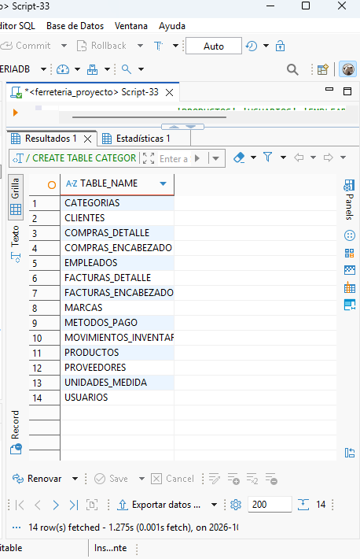

### Paso 3: cargar los datos de prueba

El script 03 termina con tres verificaciones.

**Verificación 1: conteo de registros por tabla.** Resultado esperado:

| Tabla | Filas | Tabla | Filas |
|---|---|---|---|
| `CATEGORIAS` | 8 | `PRODUCTOS` | 30 |
| `MARCAS` | 8 | `COMPRAS_ENCABEZADO` | 17 |
| `UNIDADES_MEDIDA` | 7 | `COMPRAS_DETALLE` | 34 |
| `METODOS_PAGO` | 5 | `FACTURAS_ENCABEZADO` | 14 |
| `PROVEEDORES` | 15 | `FACTURAS_DETALLE` | 39 |
| `CLIENTES` | 18 | `MOVIMIENTOS_INVENTARIO` | 66 |
| `EMPLEADOS` | 15 | `USUARIOS` | 15 |

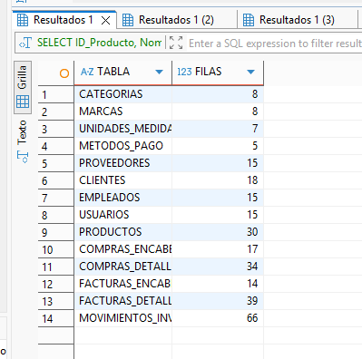

**Verificación 2: coherencia entre el stock y el kárdex.** Debe devolver **0 filas**.

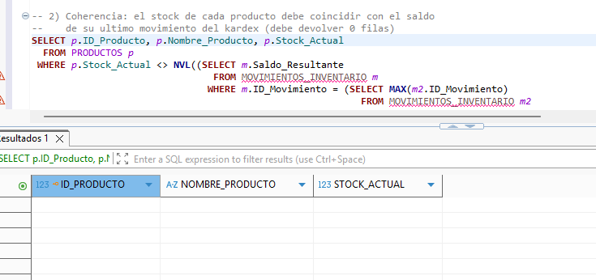

**Verificación 3: productos en o bajo el stock mínimo.** Debe devolver **7 filas**; el casco de seguridad aparece con stock 0.

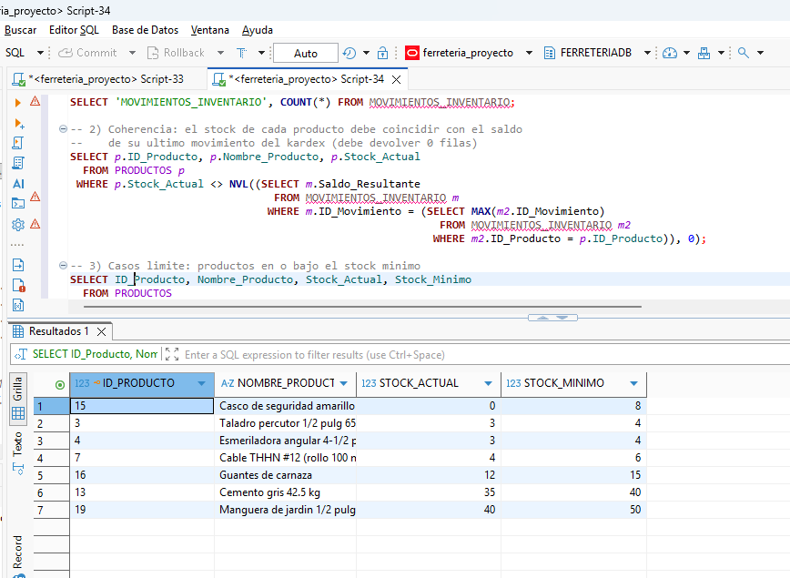

### Paso 4: consultas y reportes

El script 04 contiene 12 consultas. Resultados esperados con los datos iniciales:

| Consulta | Propósito | Resultado esperado |
|---|---|---|
| 1 | Productos más vendidos entre junio y septiembre | 10 filas; primero cemento gris: 215 unidades, Q 21,070.00 |
| 2 | Ventas totales por cliente | 18 filas, ordenadas por total gastado; primero el Taller Mecanico El Rapido: Q 10,371.20 |
| 3 | Compras por proveedor y categoría | 10 filas; el proveedor Materiales de Construccion El Roble suma Q 21,420.00 sin IVA |
| 4 | Kárdex del cemento | 5 movimientos; saldo final 35 |
| 5 | Cierre de caja por forma de pago | 5 filas; transferencia Q 13,444.48 (34.07 %) |
| 6 | Clientes y proveedores sin operaciones | 7 filas (4 clientes y 3 proveedores) |
| 7 | Desempeño de vendedores | 5 filas; primero Kevin Sipac Tohom: 4 facturas, Q 16,204.16 |
| 8 | Productos con bajo stock | 7 filas; primero el casco de seguridad (stock 0) |
| 9 | Productos con su categoría y proveedor (`JOIN`) | 30 filas |
| 10 | Factura completa (FAC-0003) | 3 líneas; subtotal Q 6,980.00, IVA Q 837.60, total Q 7,817.60 |
| 11 | Productos nunca vendidos (subconsulta `NOT EXISTS`) | 10 filas: los productos 21 al 30 |
| 12 | Ventas por mes (junio a octubre de 2026) | 5 filas; junio 3 facturas, Q 10,077.76; octubre 1 factura, Q 4,005.12 |

Las consultas 1, 3, 6 y 7 usan funciones de agregación con `HAVING`; la 11 usa una subconsulta. Capturas de algunas consultas:

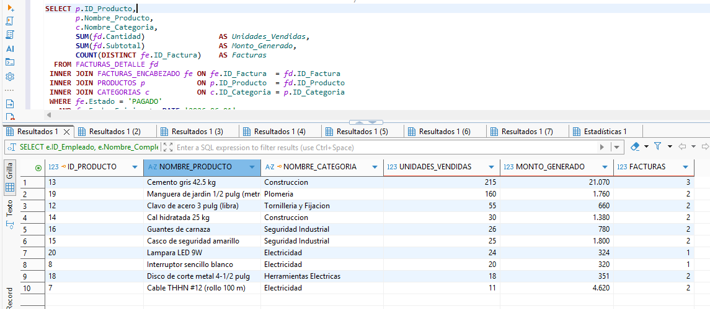

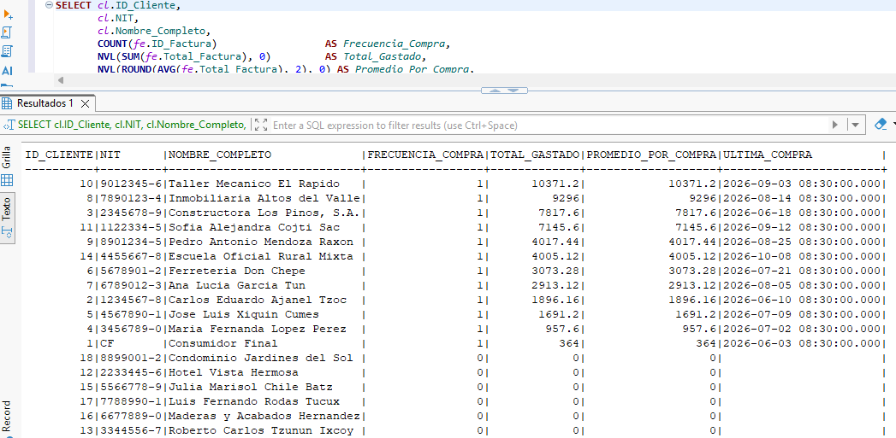

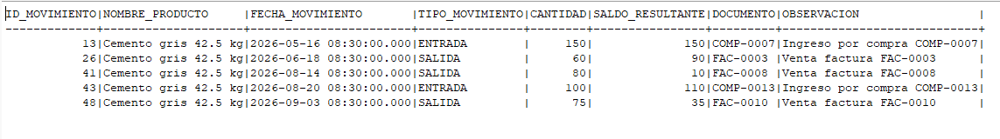

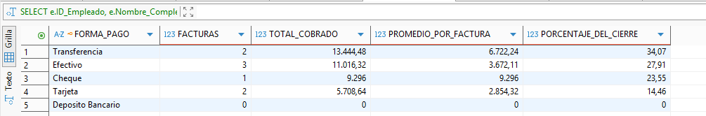

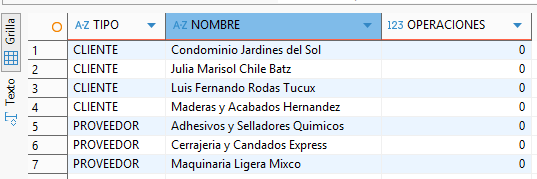

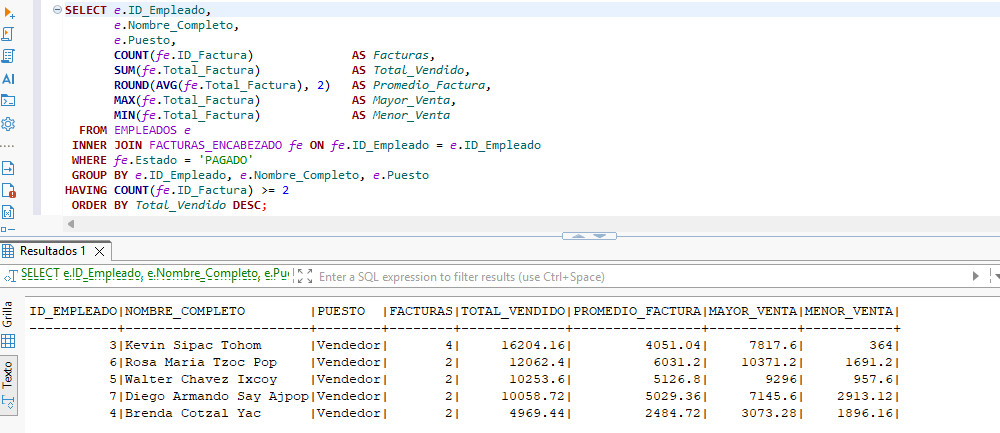

Consulta 8, productos con bajo stock:

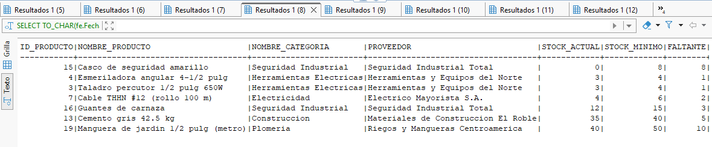

Consulta 9, productos con su categoría y proveedor (30 filas, en dos capturas):

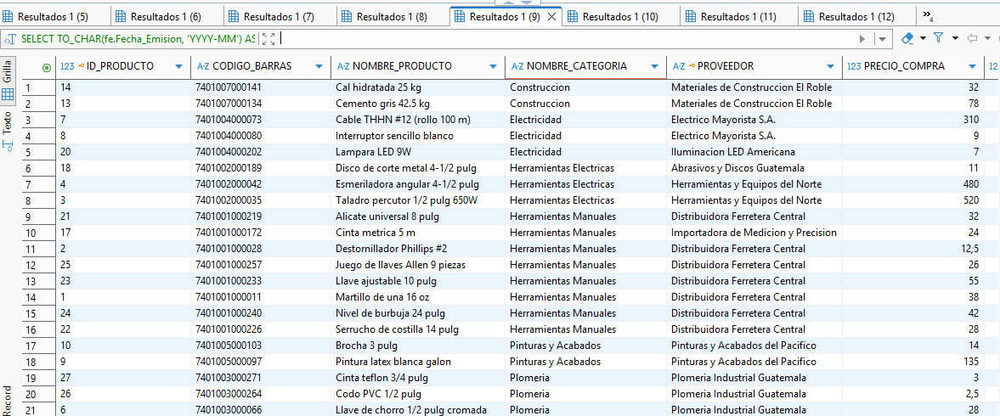

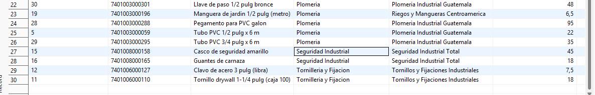

Consulta 10, factura completa FAC-0003 (columnas en dos capturas):

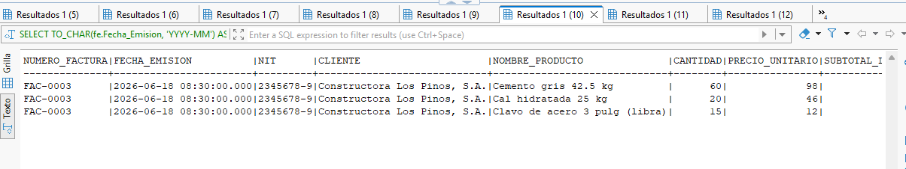

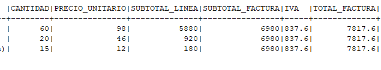

Consulta 11, productos nunca vendidos:

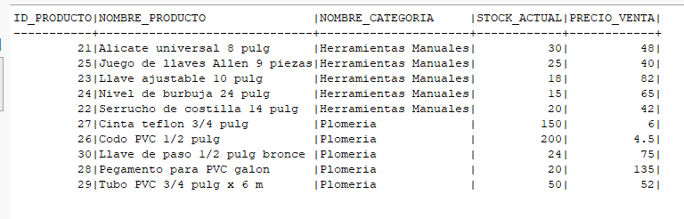

Consulta 12, ventas por mes:

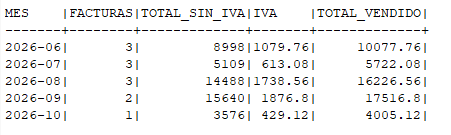

Consulta 3, compras por proveedor y categoría:

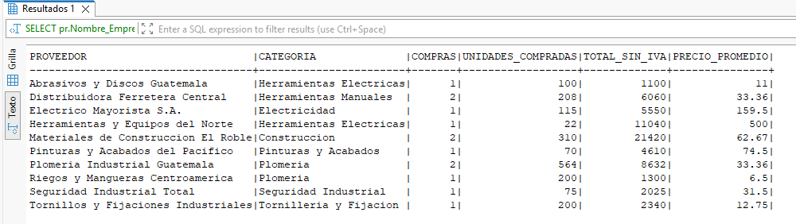

### Paso 5: lógica automática

**Verificación 1: objetos creados.** Deben aparecer 11 filas, todas con estado `VALID` (3 `TRIGGER`, 4 `TYPE`, 2 `PROCEDURE` y 2 `VIEW`):

```sql
SELECT object_type, object_name, status FROM user_objects
 WHERE object_type IN ('TRIGGER','TYPE','PROCEDURE','VIEW')
 ORDER BY object_type, object_name;
```

**Verificación 2: vista de inventario crítico.** Debe devolver 7 filas (los productos en o bajo el mínimo, uno de ellos agotado):

```sql
SELECT COUNT(*) FROM VW_INVENTARIO_CRITICO;
```

**Pruebas de funcionamiento.** Ejecute cada bloque por separado. Las pruebas terminan con `ROLLBACK` para dejar los datos como estaban; en DBeaver cambie antes el modo de transacción de *Auto* a *Manual* y presione **Rollback** al terminar cada prueba, o el `ROLLBACK` no tendrá efecto. En SQL*Plus ejecute antes `SET SERVEROUTPUT ON`.

*Prueba A: el trigger bloquea una venta sin stock.* Debe fallar con `ORA-20001` (el casco, producto 15, tiene stock 0):

```sql
INSERT INTO FACTURAS_DETALLE (ID_Factura, ID_Producto, Cantidad, Precio_Unitario, Subtotal)
VALUES (12, 15, 1, 72.00, 72.00);
```

*Prueba B: facturar con el procedimiento.* Vende 3 destornilladores (producto 2). Se espera la factura `FAC-0015` con subtotal 66.00 (3 × Q 22.00), IVA 7.92 y total 73.92, y el stock del producto 2 pasa de 45 a 42:

```sql
DECLARE
    v_id NUMBER; v_num VARCHAR2(20);
BEGIN
    SP_REGISTRAR_FACTURA(1, 3, 1, T_LINEAS_VENTA(T_LINEA_VENTA(2, 3)), v_id, v_num);
    DBMS_OUTPUT.PUT_LINE('Factura creada: ' || v_num);
END;
/
SELECT Numero_Factura, Subtotal, Impuesto, Total_Factura, Estado
  FROM FACTURAS_ENCABEZADO WHERE Numero_Factura = 'FAC-0015';
SELECT Stock_Actual FROM PRODUCTOS WHERE ID_Producto = 2;
ROLLBACK;
```

*Prueba C: comprar con el procedimiento.* Compra 10 martillos (producto 1) al proveedor 1. Se espera `COMP-0018` con subtotal 380.00, IVA 45.60 y total 425.60, y el stock del producto 1 pasa de 37 a 47:

```sql
DECLARE
    v_id NUMBER; v_num VARCHAR2(20);
BEGIN
    SP_REGISTRAR_COMPRA(1, 14, T_LINEAS_COMPRA(T_LINEA_COMPRA(1, 10, NULL)), v_id, v_num);
    DBMS_OUTPUT.PUT_LINE('Compra creada: ' || v_num);
END;
/
SELECT Numero_Compra, Subtotal, Impuesto, Total_Compra
  FROM COMPRAS_ENCABEZADO WHERE Numero_Compra = 'COMP-0018';
SELECT Stock_Actual FROM PRODUCTOS WHERE ID_Producto = 1;
ROLLBACK;
```

## 7. Problemas comunes y cómo resolverlos

| Problema | Causa | Solución |
|---|---|---|
| `ORA-00955: name is already used by an existing object` | Quedaron objetos de una instalación anterior | Ejecutar primero `sql/01_ddl_crear_base_datos.sql` |
| `ORA-00942: table or view does not exist` | Los scripts se ejecutaron en otro orden | Repetir desde el script 01 y respetar el orden numérico |
| `ORA-01031: insufficient privileges` | El esquema no tiene permiso para crear tablas | Pedir al administrador que otorgue `CREATE TABLE` |
| `ORA-00001: unique constraint violated` al cargar datos | El script 03 se ejecutó dos veces sin limpiar | Ejecutar 01, 02 y 03 de nuevo |
| En DBeaver el script 01 no hace nada o marca error en la línea `/` | DBeaver no procesa esa línea de cierre | Seleccionar el bloque sin la `/` y ejecutar con Ctrl + Enter |
| DBeaver muestra los números con coma decimal | Configuración regional del cliente | Es solo de presentación; los valores almacenados son los mismos |
| `ORA-20001: Stock insuficiente` | Se intentó vender más unidades de las que hay | No es un error del script: es la validación de stock funcionando |
| `Warning: ... created with compilation errors` al correr el script 05 | Falta alguna tabla o el script 03 no se ejecutó | Ejecutar `SHOW ERRORS` (SQL*Plus), revisar el orden 01 a 05 y repetir |
